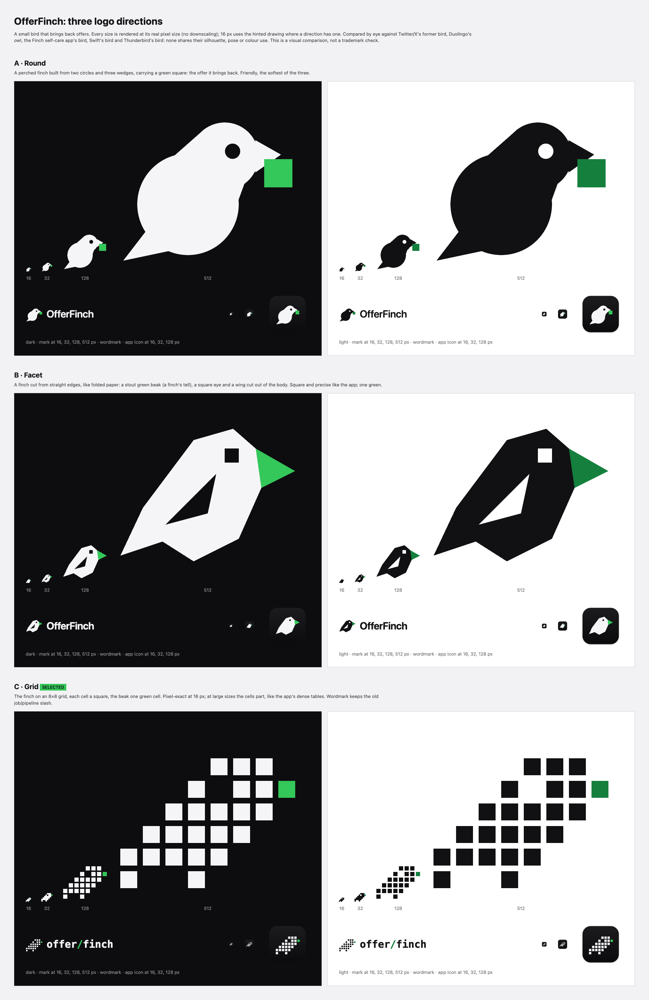

# OfferFinch brand

OfferFinch is a small bird that brings back offers. The mark follows the app's design language: dark, square corners, precise edges, one accent green.



## Directions

| | Idea | At 16 px |
|---|---|---|
| **A · Round** (`round/`) | A perched finch from two circles and three wedges, carrying a green square (the offer). The friendliest. | Reads as a bird; the square shrinks to a dot. |
| **B · Facet** (`facet/`), **selected** | A finch cut from straight edges: a stout green beak (a finch's tell), a square eye, a wing cut out of the body. | A hinted drawing on the 16 px grid, without the wing. |
| **C · Grid** (`grid/`) | The finch on an 8×8 grid of squares, the beak one green cell; wordmark `offer/finch`, the two words split by a slash. | Pixel-exact, but the most "8-bit" at large sizes. |

Facet was picked because it is the most precise and square of the three and still reads as a finch (stout conical beak, compact body, notched tail) at 16 px. Round is softer and closer to the generic "cute bird" look; Grid is the crispest at 16 px but looks retro at app-icon size.

**Compared against** (by eye, not a trademark search): Twitter/X's former bird (curved, wing raised, blue, faces up-right), Duolingo's owl (front-facing, green body), the Finch self-care app's bird (a round front-facing chick), Swift's bird (a swift in flight in an orange gradient) and Thunderbird's bird (wrapped around an envelope). Facet is a side-on perched silhouette made only of straight edges, in white or black, with green only on the beak. **This is a visual comparison, not a trademark check.** Clear the name and mark with a trademark search before any public release.

## Colours

| Token | Value | Use |
|---|---|---|
| ink | `#0d0d0f` | App icon, DMG, dark ground |
| on dark / on light | `#f5f5f7` / `#111113` | The bird's body |
| green on dark | `#34c759` | Beak on dark (9.6:1 on ink) |
| green on light | `#15803d` | Beak on light (5.0:1 on white) |

In the app the green is `--brand` (`apps/desktop/src/renderer/index.css`); the body follows the text colour.

## Files

- `marks.mjs`: the geometry of all three directions (32-unit grid), the hinted 16 px drawings, the one-colour menu bar glyphs, the wordmarks and the app icon layout. **`SELECTED`** names the direction the app uses.
- `<direction>/`: `mark-dark.svg`, `mark-light.svg` (and `mark-16-*.svg` where hinted), `wordmark-dark.svg`, `wordmark-light.svg` (live text in the system font; outline it before print use), `app-icon.svg`, `menu-bar-template.svg`, `menu-bar-attention-template.svg`.
- `dmg-background.svg`: the DMG window art for the selected direction.
- `options.png`: the comparison sheet, every size rendered at its real pixel size.

## Rendering, and switching direction

```bash
cd apps/desktop
node scripts/icons.mjs                      # everything, for SELECTED in docs/brand/marks.mjs
node scripts/icons.mjs --direction round    # try another direction without editing SELECTED
```

It uses the installed Google Chrome (headless) and writes:

- `build/icon.icns` (each iconset size rendered on its own, 16 px from the hinted drawing, packed with `iconutil`) and `build/icon.png`, used by macOS 13 to 15;
- `build/OfferFinch.icon` (an Icon Composer document: the dark fill and the bird as one layer) compiled with `actool` (Xcode 26 or later, only needed to re-render) into `build/Assets.car`, which macOS 26 and later read through `CFBundleIconName`. Without it macOS 27 shows the `.icns` on a grey plate at small sizes (checked with `NSWorkspace.iconForFile` at 32 px);
- `build/volume.icns` (the DMG's volume icon) and `build/background.tiff` (the DMG window, 1x and 2x via `tiffutil`);
- `assets/trayTemplate.png` and `@2x` (menu bar, 16 pt, black and alpha only, so macOS tints it), and `assets/trayAttentionTemplate.png` and `@2x` (the same with a square at the top right, shown when the last scan stopped or failed);
- `src/renderer/public/favicon.svg` and `src/renderer/components/brand-mark.tsx` (the in-app mark, generated; do not edit).

To switch for good, set `SELECTED` in `marks.mjs`, run the script, rebuild.

## App icon

Apple's macOS grid: a 1024 canvas, an 824 rounded square inset 100 with a 185.4 corner, a soft shadow 10 below it (30% black, 10 blur), a faint 9% white edge. The bird takes about 68% of the body's width, nudged up and right because its mass sits low and left.
