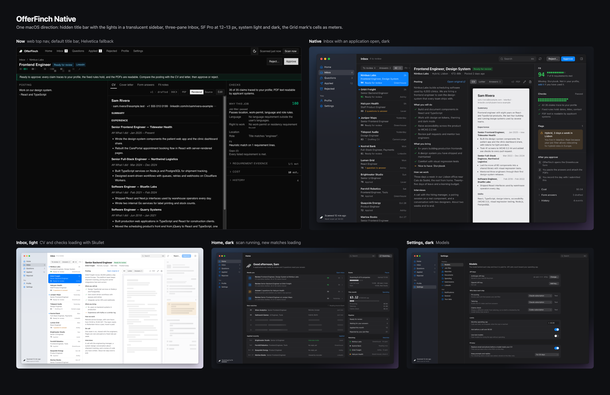

# OfferFinch Native: the desktop design (2026-11-02)

One direction for making OfferFinch read as a Mac app, not a web page in a window. Design only: nothing in `apps/desktop` has changed yet. The user dropped the square-corner direction and chose rounded corners, and the Grid mark (`SELECTED = "grid"` in `docs/brand/marks.mjs`). Everything below is built on those two choices.

| File | What it shows |
|---|---|
| `inbox-dark.png` | Inbox with Nimbus Labs open: list, posting and CV side by side, inspector with fit, checks and flags |
| `inbox-light.png` | The same layout in light, a moment after picking Orbit Freight: posting loaded, CV and checks still loading (Skullet) |
| `home-dark.png` | Home during a scan: what needs you, new matches arriving (Skullet rows), spend, watchlist |
| `settings-dark.png` | Settings, Models section |
| `directions.png` | The current Application screen beside the new Inbox, then the other three stills |
| `src/offerfinch-native/` | The scene sources (React and CSS, stageshow kit); see `src/REHEARSAL.md` to re-film |

Every name, company and posting is made up (Sam Rivera and invented companies). The stills are a 1440 × 900 window drawn at 1:1, so 13 px type in the image is 13 px in the app.

## Why it reads as a web page now

Ranked by how much each one gives it away. The evidence comes from the code at `fb81a53` and from `docs/screenshots/desktop/`.

1. **The type is Helvetica, not SF Pro.** `packages/ui/src/styles/globals.css` sets `@theme inline { --font-sans: "Inter Variable", sans-serif }`. Tailwind inlines that value into `body` and `.font-sans`, and the build ships no `@font-face` (0 in `out/renderer/assets/*.css`), so every screen falls back to `sans-serif`, which is Helvetica. The desktop override in `apps/desktop/src/renderer/index.css` (`:root { --font-sans: -apple-system … }`) is never read. This is the strongest single "web" tell, and it is a one-line fix.
2. **A default title bar sits above a website header.** `titleBarStyle: "default"` (`src/main/index.ts:145`) draws the grey macOS bar with the window title, and under it the renderer draws its own 40 px header. That is two bars, and the traffic lights are not part of the app.
3. **Navigation is a top nav with underline tabs.** `components/pipeline/nav.tsx` is a `<header>` holding text links with `border-b-2` for the active page and inverted black squares for counts. This is a marketing-site pattern. There is no sidebar.
4. **Content sits in a centred column on a void.** Home, Questions, Settings and Onboarding wrap everything in `mx-auto max-w-5xl md:border-x` (`home.tsx:250`, `questions.tsx:41`, `settings/index.tsx:63`). At 1280 px, `05-home-dark.png` shows bands on both sides and an empty bottom half.
5. **The Inbox is a table that navigates away.** Each row is a `<Link href="/applications/:id">` (`inbox.tsx:340`). Opening an application drops the list, and the table stops after five rows over white (`06-inbox-light.png`). There is no master-detail.
6. **There is no app menu of its own.** Nothing calls `Menu.setApplicationMenu`, so Electron's default menu shows (View › Reload and Toggle Developer Tools; Help links to electronjs.org). There is no Go menu, no ⌘1…⌘7, and no ⌘, for Settings.
7. **There is no keyboard or right-click use.** The only key handler is ⌘↩ in Questions (`questions.tsx:102`). No list takes arrow keys, nothing has a context menu, and there is no command menu.
8. **The theme is a website toggle, and dark starts with a white flash.** `ModeToggle` sits in the header. `backgroundColor: "#ffffff"` (`index.ts:144`) paints white before the dark CSS loads.
9. **Loading is a spinner and a page reload.** `components/loader.tsx` is a centred `Loader2 animate-spin`, and a worker restart calls `window.location.reload()` (`app.tsx:26`). The screen blanks the way a browser tab does.
10. **The controls are admin-dashboard boxes, not Mac controls.** There are 48 `rounded-none` classes in 15 files. Labels are uppercase and tracked (POSTING, CHECKS, WHY THIS JOB), and Markdown leaks into the CV preview (`## What I did`). The model choice is a row of black and white boxes (`09-settings-models-*.png`). There are no push buttons, pop-up buttons, switches or grouped forms of the kind every Mac app uses.

## The design

### Window

- **The title bar is hidden and the lights sit in the sidebar.** The sidebar runs the full height with the traffic lights in its top. The content column has a 52 pt unified toolbar: the page title on the left, actions on the right.
- **The sidebar is translucent.** It uses Electron's native `vibrancy`, and the desktop tints it. The stills draw that tint and no CSS blur: the system does the blur, and a CSS `backdrop-filter` would cost GPU memory.
- **Drag regions.** The toolbar and the sidebar top are `-webkit-app-region: drag`. Every control inside them is `no-drag`.
- **Light and dark follow the system.** The theme toggle goes. `nativeTheme` sets the window background, so there is no white flash in dark.
- **The minimum window is 960 × 600.** Below 1180 wide, the inspector folds into the toolbar's panel button and opens over the detail. Below 1040, the list narrows to 240 and the posting and CV become two tabs.

### Look: rounded, and built from the mark

- **Radii are steps of the mark's 4-unit grid:** 2 for cells, 4 for chips, keys and the CV page, 6 for buttons, fields, sidebar rows and list rows, 8 for list selection and the flag box, 10 for grouped panels and menus, and 12 for the window.
- **The mark's cells become meters.** Fit is 10 cells, each claim checked is one cell (35 of 35), each company in a scan is one cell, and spend is one cell per dollar of the cap. The cells part by a hair, like the mark above 32 px.
- **Green is the beak: one cell, one signal.** It means a high fit, a traced claim or a met requirement, and nothing else. Buttons, selection, toggles and links take the system accent (blue by default, read with `systemPreferences.getAccentColor()`), the way Mail, Notes and Things do. Amber means needs you: questions, flags, gaps.
- **The mark appears twice.** It sits at 16 px, cells touching, in the sidebar foot beside the scan status, and at 40 px, cells parted, in Home's greeting. The `offer/finch` wordmark's monospace carries into the numbers: fit, cost and dates are `ui-monospace` tabular figures.
- **Type is SF Pro through `-apple-system`:**
  - 13 px for body, sidebar and rows;
  - 12–12.5 px for secondary text and meta;
  - 11–11.5 px for times and group labels;
  - 15 px bold for the toolbar title, 19 px bold for the page title, 22 px bold for Home's greeting.
  - No uppercase labels.

### Screens

- **Sidebar:**
  - Home, Inbox 4, Questions 3, Applied 12, Rejected; then You › Profile and Settings.
  - Counts are plain grey numbers, as in Mail.
  - The selected row has a neutral fill, and the icons take the accent.
  - The foot shows the scan state: "Scanned 12 min ago · Next scan at 14:00", or "Scanning 6 of 9" with cells.
- **Inbox, three panes:**
  - **List (288).** Each row has the company, role, fit, state and board. A dot marks unread, and the selection takes the accent. Tabs above it: To review 4, Answers 3, All 48. Arrow keys move through it.
  - **Application.** The title, a status pill and one meta line sit above the posting and documents, side by side. Each requirement line in the posting carries a tick (met) or an amber dash (gap), so you compare it with the CV without a separate list. The CV shows as the PDF page it is, with CV, Letter and Answers tabs.
  - **Inspector (276).** It shows:
    - Fit, with the gap and how to fix it;
    - Checks, as 35 cells and three lines;
    - Flags, such as hybrid in Lisbon and why the job was kept;
    - After you approve, the three hand-off steps;
    - Cost, form answers and history, folded away.
  - **Toolbar.** Search ⌘K, Scan now, Reject…, Approve, and the inspector toggle. Approve and Reject show only in review. Approve stays dimmed until the CV and checks have loaded (`inbox-light.png`).
  - **Deep links.** `/applications/:id`, from the tray and notifications through `IPC.navigate`, opens this view with that row selected.
- **Home:**
  - The greeting with the mark, and one sentence on what is waiting.
  - **Needs you:** review and answer tasks with fit and age.
  - **New matches:** scored rows arrive while Skullet holds the shape of the ones being read.
  - **Applied recently:** reply states.
  - **Right column:** Scans (cells, last and next), This month (one big figure, cells against the cap, cost by step), Pipeline counts, and Watching (board health).
- **Settings.** The same ten sections, keeping their URLs. They are listed in a second column, like System Settings, with grouped forms: a label and hint on the left, a native control on the right (pop-up button, switch, field, push button). The stills show Models: API keys, who does each step, limits and privacy.

### Interaction

- **⌘1…⌘7** go to Home, Inbox, Questions, Applied, Rejected, Profile and Settings. They are also in a Go menu. **⌘,** opens Settings.
- **⌘K** opens a command menu: go to a page, find an application by company or role, Scan now, Pause scans, open the posting, copy its link. **It has no Approve command, and no key approves** (`docs/ux-pass.md`: an accidental key press must not approve). Reject still asks for a reason.
- **In the list:** ↑ and ↓ move the selection, ↩ moves focus into the application, and ⌘⌥I shows or hides the inspector.
- **Right-click a row** for Open posting, Copy link, Answer questions and Reject…. These are real `NSMenu`s through `Menu.popup` from main, not drawn in the page.
- **Hover and selection.** Hover is a 5% fill inset in the list. Selection is the accent when the list has focus and neutral grey when it does not, as in Mail. No transitions longer than 120 ms.

### Skullet for loading

`skullet` 0.0.3 (MIT) by Lochie, <https://skullet.lochie.me>:

- **How it works.** `<Skeleton loading data sample>` lays out the real component with sample data and measures it (`getClientRects`, `measureText`), so the skeleton has the content's own geometry. Pass `id` and it remembers the shape in `localStorage`.
- **React.** `skullet/react` exports `Skeleton`, `SkeletonBox`, `SkeletonSuspense` and `SkulletProvider`. Peers are `react` and `react-dom` 18 or later; the app is on 19.
- **Offline.** It is client-only and needs no server render. I inspected the published 0.0.3 tarball: the only URL in `dist/` is the SVG namespace. It makes no `fetch`, XHR, beacon or socket calls, and uses no fonts or CDN.
- **Size.** The React entry is 6.1 KB, 2.6 KB gzipped.
- **Electron.** The stills render with the real package in Chrome. Its CSS uses `@scope`, which Chromium supports from 118, and Electron 45 is newer.
- **Theme for OfferFinch.** `radius: 4px`, the `shimmer` animation, light base `rgba(0,0,0,.07)`, dark base `rgba(255,255,255,.08)`. It holds still under reduced motion.
- **Pin it.** It is pre-1.0 (0.0.3, published 2026-10-31), so pin the exact version.
- **CSP.** It injects a `<style>` element and adopted stylesheets. The app's CSP (`src/main/protocol.ts:14`) has `style-src 'self' 'unsafe-inline'`, so it needs no nonce.
- **Off-screen panes, a risk for step 11.** With all four stills on one page, the stages below the fold drew no bones: the loading layer stayed empty. Rendered alone in view, each drew correctly. I did not find out why. Check it with a virtualised list and with panes that scroll into view before relying on it there; the fallback is `SkeletonBox` rows written by hand.
- **Where it goes.** The Inbox list, the CV pane and the inspector while an application loads, Home's new matches during a scan, and every Settings section. It replaces `Loader`'s spinner everywhere.

## Implementation plan

The estimates are for one person, based on the files involved. The e2e suite (`apps/desktop/e2e/desktop.spec.ts`) covers the flows, and each step keeps it green.

| # | Step | Files | Estimate |
|---|---|---|---|
| 1 | **Use SF Pro.** Override `--font-sans` with `@theme` in the desktop CSS (or drop Inter from `packages/ui` `@theme inline`), then check that the built CSS says `-apple-system` | `renderer/index.css` | 15 min |
| 2 | **Window chrome.** `titleBarStyle: "hidden"`, `trafficLightPosition` centred in a 52 pt bar (about `{ x: 20, y: 19 }`; check against macOS 26's larger lights), `vibrancy: "sidebar"`, `visualEffectState: "followWindow"`, background from `nativeTheme`, minimum 960 × 600, drag regions | `main/index.ts` `createWindow` | 2–3 h |
| 3 | **App menu.** App, File, Edit, View, Go (⌘1…⌘7), Window, Help; ⌘, for Settings; remove Reload and DevTools from release builds | `main/index.ts` | 2 h |
| 4 | **Shell.** A `Sidebar` (counts from the existing `inbox.counts` and `questions.list` queries) and a `Toolbar` slot per page replace `AppNav`. Drop `ModeToggle`; take the accent from `systemPreferences` over IPC | `app.tsx`, `components/pipeline/nav.tsx`, `mode-toggle.tsx`, `preload`, `shared/bridge.ts` | 1 day |
| 5 | **Tokens and controls.** Radius scale, surfaces, inks, accent and status colours. Remove the 48 `rounded-none`. Restyle the shadcn Button, Input, Select, Tabs (as a segmented control), Checkbox and Switch to Mac proportions. Drop the uppercase labels | `renderer/index.css`, `packages/ui` components or desktop-only variants | 1–1.5 days |
| 6 | **Inbox master-detail.** `/inbox` and `/applications/:id` render one three-pane layout. The list is virtualised (`@tanstack/react-virtual` is already a dependency), with arrow keys and focus handling. Requirement ticks in the posting. The inspector is rebuilt from `details.tsx`, `flags.tsx` and `status.tsx`, with a `Cells` meter | `pages/inbox.tsx` (477), `pages/application.tsx` (575), `components/pipeline/application/*` | 3 days |
| 7 | **Context menus.** IPC from the renderer to `Menu.popup` in main, for list rows and the CV pane | `main`, `preload`, `inbox.tsx` | 3 h |
| 8 | **Home** in two columns, no centred column, the greeting with the mark | `pages/home.tsx` (603) | 1 day |
| 9 | **Settings:** a section column and grouped form rows. The ten section components keep their logic; `settings/shared.tsx` gets a `FormRow` | `pages/settings/*`, `components/pipeline/settings/*`, `components/desktop/*` | 1.5 days |
| 10 | **Questions, Applied, Rejected, Profile and Onboarding** moved to the sidebar layout with full-width lists | `pages/*.tsx` | 1–1.5 days |
| 11 | **Skullet** in lists and panes. Remove `Loader`. Replace the worker-restart reload with a query refetch | `app.tsx`, the pages above | 0.5 day |
| 12 | **⌘K command menu**, lazy-loaded so it costs nothing until first opened | new `components/command-menu.tsx` | 1 day |
| 13 | **Proof:** update the e2e selectors (14 lines touch nav, links or the wordmark), retake `docs/screenshots/desktop/`, and measure start and memory again | `e2e/`, `README.md` | 1 day |

**Total: about 12 to 14 working days.** Steps 1 to 3 take about a day and remove the five loudest tells (type, two bars, website nav, white flash, the Electron menu) before any screen is redesigned. They are worth doing first even on their own.

## Memory and start time

The targets are 150 MB idle with the window open (measured 162 MB) and the current 0.75 s start.

- **The hidden title bar and traffic-light position** cost nothing. They are window flags with no extra process and no extra layer.
### Vibrancy A/B (measured 2026-11-01)

Same packaged build and the same settled data, vibrancy off (A) and on (B), interleaved, five 5-minute idle runs each with the window open (`scripts/measure.mjs --only=open`, `OFFERFINCH_MEASURE_VIBRANCY`). Physical footprint summed over the app's five processes, RSS in brackets:

| Run | 1 | 2 | 3 | 4 | 5 | Mean |
|---|---|---|---|---|---|---|
| A, off | 169 (450) | 177 (452) | 169 (412) | 152 (391) | 157 (413) | **164.8 MB** |
| B, on | 170 (436) | 177 (419) | 179 (416) | 157 (395) | 158 (472) | **168.2 MB** |

Vibrancy costs about 3.4 MB on average, inside the run-to-run spread (152 to 179 MB); the GPU process alone moves between 43 and 71 MB across runs of either kind. Kept on: it is what makes the sidebar native. Its faint text is darkened under vibrancy so it stays readable (system.md, "Sidebar material").

- **`vibrancy`:** measured, see Vibrancy A/B above. The blur is drawn by the WindowServer outside Chromium; the transparent page behind the sidebar is what could cost GPU memory, and the A/B puts it inside the noise.
- **Things in the design that hold memory down:**
  - no CSS `backdrop-filter`, shadows only on static surfaces, and no animation at idle;
  - Skullet only while something loads, at 2.6 KB;
  - ⌘K and the inspector's folded sections as lazy chunks;
  - a virtualised list;
  - native `NSMenu` context menus;
  - one window and one renderer, so Settings is not a second `BrowserWindow`, which would add a renderer process. For scale, the README measured a windowless renderer at a 28 MB footprint.
- **Start time.** The shell (sidebar and toolbar) is static, and pages stay split one chunk per screen as they are now (`app.tsx`). Inbox renders the same panes the Application page renders today. I expect start to stay near 0.75 s, but that is not measured; step 13 measures it.
- **Unchanged risk.** This design does not fix the 162 MB. Its cause is not isolated in the README, and the GPU process variation is most of the gap.

## Recommendation

Build Native in the order of the plan. Steps 1 to 3 change how the app feels in a day. Measure `vibrancy` with the A/B before step 4, so the sidebar's material is settled before the shell is built.

## Not checked

- The stills are drawn, not running Electron. The traffic-light position, the vibrancy tint over a real wallpaper and the 52 pt toolbar must be checked in the real window on macOS 15 and 26.
- No fresh-eye review by another provider was run on the stills. The self-review is in `src/REHEARSAL.md`.
- Contrast was computed only for the main ink pairs. Faint text is `#8e8e93` on `#1c1c1e` in dark (5.2:1) and `#6e6e73` on white in light (5.1:1); these were raised from 3.6:1 and 3.4:1 in the first pass. Faint text on the translucent light sidebar is about 4.2:1. That is under 4.5:1, so the sidebar counts need the strong ink or a darker tint.
