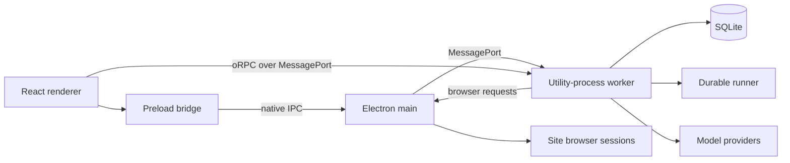
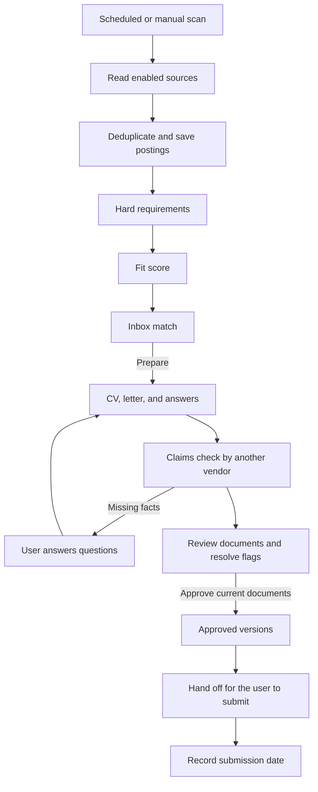

# Local desktop workflows

OfferFinch runs on one Mac. Electron main owns native UI and secrets. A utility-process
worker owns SQLite, the durable runner, source readers, model calls, and oRPC procedures.
The React renderer reaches those procedures over a private MessagePort, with no HTTP
server or listening port.

A scheduled scan (hourly by default; Settings › General sets the interval and quiet hours),
or **Scan now**, runs enabled source providers. New postings are deduplicated, filtered, and
scored. A suitable match waits in the Inbox until **Prepare** is selected.
A check or sign-in request holds its source for the user; existing retry and stop rules
control subsequent attempts.

The existing submission path remains guarded for supported automatic boards; fixture tests
exercise it headlessly. Current product boards use hand-off. Edits, stale evidence, payment
uncertainty, and site checks retain their existing approval, billing, and stop behavior.

The runner stores runs, steps, leases, and events in SQLite. Completed steps are not repeated
after a crash. Application actions and their workflow events commit together; recovery and
stall handling resume or end work through the same persisted state machine. Closing the
window leaves the worker running; quitting shuts it down.

See [the desktop system](design/desktop/system.md), [decisions](decisions.md), and
[cleanup verification](cleanup-baseline.md) for design rules, historical decisions, and test
evidence. The former Cloudflare diagram and web-only UX walkthrough were retired with the
web product.
